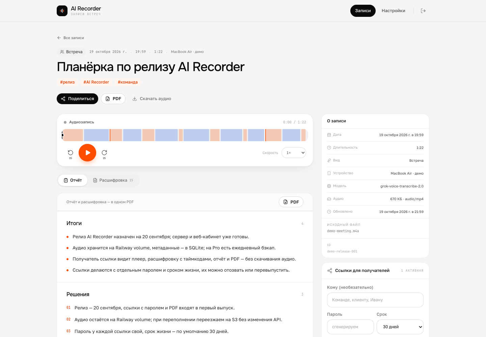

# AI Recorder Web

Единая база записей AI Recorder: встречи и звонки из Android и Mac попадают на сайт вместе с
расшифровкой и отчётом. Владелец входит одним паролем, слушает записи, ищет по тексту и выдаёт
получателям ссылки с паролем — без аккаунта и без скачивания аудио.

Сделано под экосистему `km0xrl-airecorder-android` и `km0xrl-airecorder-mac`. Контракт приёма
совместим с документом библиотеки приложения (`source_name`, `kind`, `transcript`, `report`,
`speaker_names`, `tags`) и описан в [docs/API.md](docs/API.md).



## Что умеет

- **Личный кабинет.** Один владелец и один пароль; все записи с устройств в одном списке.
- **Плеер.** Онлайн-прослушивание с перемоткой, ±15 секунд, скоростью, таймлинией по говорящим и
  метками. Аудио отдаётся с поддержкой `Range`, поэтому запись не качается целиком.
- **Расшифровка.** Фразы с таймкодами, имена говорящих, поиск по тексту, переход к месту по клику,
  фильтр по говорящему, подсветка меток и следование текста за звуком.
- **Отчёт.** Итоги, решения, задачи, протокол в Markdown, подсказки «Стоило спросить».
- **PDF.** Отчёт и расшифровка в одном PDF — из кабинета и из защищённой ссылки.
- **Ссылки с паролем.** Свой пароль и срок у каждой ссылки; отзыв, возврат и смена пароля.
  Пароль хранится только как scrypt-хеш и показывается один раз при создании.
- **API приёма.** Метаданные JSON и аудио потоком; идемпотентность по `client_id`, синхронизация
  изменений по `updated_at_ms`. Готово для доработки Android и Mac.

## Стек

Next.js 16 (App Router, TypeScript, Tailwind CSS 4), React 19, встроенный SQLite (`node:sqlite`, WAL),
PDFKit, `music-metadata`, собственные сессии на HMAC-cookie и scrypt. Хранение — локальный том
(на Railway — volume), без внешней БД и S3 на первом этапе.

## Быстрый старт

Нужны Node.js 24+ и pnpm 11.

```bash
cp .env.example .env.local
pnpm install

# секреты
openssl rand -base64 48        # SESSION_SECRET
openssl rand -base64 36        # INGEST_TOKEN
pnpm hash-password 'ваш-пароль' # OWNER_PASSWORD_HASH

pnpm dev                       # http://localhost:3000
```

Для локальной проверки можно задать `OWNER_PASSWORD` вместо хеша. На сервере используйте
`OWNER_PASSWORD_HASH`.

### Демо-запись

```bash
pnpm demo:audio   # соберёт data/demo/meeting.m4a и манифест (macOS: say + ffmpeg)
pnpm seed-demo    # добавит запись, расшифровку, отчёт и ссылку
```

Скрипт напечатает адрес кабинета, ссылку и пароль (`demo2026`). Демо-аудио — синтезированная
встреча на русском, чтобы проверить плеер, вёрстку и PDF без реальных данных.

## Переменные окружения

| Переменная | Обязательна | Что это |
|---|---|---|
| `OWNER_PASSWORD_HASH` | да* | scrypt-хеш пароля владельца. Получить: `pnpm hash-password '…'` |
| `OWNER_PASSWORD` | да* | Альтернатива для локальной разработки; на сервере не нужна |
| `SESSION_SECRET` | да | Подпись cookie владельца и ссылок, ≥ 16 символов |
| `INGEST_TOKEN` | да | Bearer-токен для Android/Mac |
| `PUBLIC_BASE_URL` | желательно | Публичный адрес сайта, например `https://voice.km0xrl.com`. Из него строятся ссылки |
| `DATA_DIR` | да на сервере | Каталог SQLite и аудио; на Railway — `/data` |
| `MAX_AUDIO_BYTES` | нет | Лимит файла, по умолчанию 500 МБ |
| `NEXT_PUBLIC_APP_TIMEZONE` | нет | Часовой пояс отображения дат, по умолчанию `Europe/Moscow` |
| `COOKIE_SECURE` | нет | `false` — только для локальной проверки production-сборки по HTTP |

\* Нужен один из двух вариантов пароля.

В `.env` значение `OWNER_PASSWORD_HASH` содержит `$`: заключите его в кавычки и экранируйте `$`
как `\$`, либо задайте переменную прямо в панели Railway, где экранирование не нужно.

## Полная синхронизация с Android и Mac

Сайт — общая библиотека. Приложения синхронизируются с ним по протоколу Б14: `GET/PUT /v1/library`,
курсор `seq`, надгробия, правило «побеждает последняя правка». Поля — все: название, теги, расшифровка,
отчёт, имена и поправки говорящих, метки, подсказки, `tags_edited`, `voice_named`. После метаданных
приложение отправляет аудио на `PUT /api/v1/recordings/{id}/audio`; сайт отдаёт его в плеере и ссылках.

- **Android:** APK с вшитыми адресом сайта и токенами — `dist/airecorder-0.12.0-web-sync.apk`.
  Адрес и токен сайта можно поменять в «Настройках» → «Синхронизация».
- **Mac:** `dist/AIRecorder-0.2.0-web-sync.zip`. Токены вшиты в `Info.plist` при сборке.
- Пересборка: `WEB_SYNC_TOKEN=… TRANSCRIBE_TOKEN=…` для Android — через Gradle, для Mac —
  `WEB_SYNC_TOKEN=… TRANSCRIBE_TOKEN=… Scripts/bundle.sh`.

Сервер сайта принимает библиотеку на `/v1/library` и `/health` с флагом `library: true` — это тот же
контракт, что у сервиса расшифровки, поэтому приложения используют один и тот же клиент, но с адресом
сайта. Аудио в `LibraryData` не входит и загружается отдельным запросом.

## API

Полный контракт — [docs/API.md](docs/API.md). Коротко:

```bash
BASE=https://voice.km0xrl.com
TOKEN=<INGEST_TOKEN>

# 1. Метаданные: название, текст, отчёт, теги, говорящие
curl -X PUT "$BASE/api/v1/recordings/rec_demo_001" \
  -H "Authorization: Bearer $TOKEN" \
  -H "Content-Type: application/json" \
  --data @recording.json

# 2. Аудио потоком
curl -X PUT "$BASE/api/v1/recordings/rec_demo_001/audio?name=meeting.m4a" \
  -H "Authorization: Bearer $TOKEN" \
  -H "Content-Type: audio/mp4" \
  --data-binary @meeting.m4a

# 3. Проверка
curl -H "Authorization: Bearer $TOKEN" "$BASE/api/v1/recordings/rec_demo_001"
```

`GET /api/v1/health` открыт без токена — по нему Railway проверяет живость.

## Деплой на Railway

1. Запушьте репозиторий в GitHub и создайте сервис из репозитория (Dockerfile подхватится сам).
2. Добавьте **Volume** и смонтируйте его в `/data`.
3. Задайте переменные:

   ```text
   NODE_ENV=production
   DATA_DIR=/data
   PUBLIC_BASE_URL=https://voice.km0xrl.com
   OWNER_PASSWORD_HASH=<вывод pnpm hash-password>
   SESSION_SECRET=<openssl rand -base64 48>
   INGEST_TOKEN=<openssl rand -base64 36>
   ```

4. Пропишите домен в Railway → Settings → Networking, затем обновите `PUBLIC_BASE_URL`.
   Для `recorder.km0xrl.com` нужны DNS-записи, которые показывает Railway → Domains:
   `CNAME recorder → <service>.up.railway.app` и TXT `_railway-verify.recorder` с токеном проверки.
   Без них домен не откроется, хотя Railway-адрес уже работает.
5. Проверьте `https://<домен>/api/v1/health` и вход в кабинет.

На тарифе Pro включите бэкапы volume: Railway → сервис → Backups. SQLite лежит в
`/data/db/app.db`, аудио — в `/data/audio`, демо — в `/data/demo`.

`railway.json` задаёт healthcheck `/api/v1/health`. Контейнер работает одним инстансом: SQLite и
локальный том не рассчитаны на горизонтальное масштабирование.

## Проверки

```bash
pnpm typecheck
pnpm test
pnpm build
pnpm start      # production-сервер после сборки
```

## Безопасность и ограничения

- Кабинет закрыт cookie `HttpOnly`/`SameSite=Lax`, пароль владельца проверяется через scrypt.
- Пароли ссылок хранятся только как scrypt-хеш; после создания пароль нельзя показать — можно
  сменить, получив новый.
- Попытки входа и разблокировки ограничены по IP; ссылки имеют срок и отзыв.
- Все страницы закрыты от индексации (`noindex`), аудио отдаётся только после проверки cookie.
- «Без скачивания» — это отказ от кнопки и `Content-Disposition: inline`. Технически браузер
  всё равно получает звук, и пользователь с инструментами разработчика может его сохранить.
  Полноценная защита от скачивания требует DRM и в MVP не делалась.
- Аудио не транскодируется: сайт отдаёт исходный файл, который прислало приложение.
- Веб-правки названия и тегов пока не уезжают обратно в Android/Mac автоматически; API для
  вычитывания (`GET /api/v1/recordings?since=…`) уже есть. Двусторонняя синхронизация — следующий шаг.
- Один владелец. Роли, организации и несколько пользователей не входят в MVP.

## Структура

```
app/
  (owner)/              кабинет: записи, запись, настройки
  s/[token]/            защищённая страница получателя
  api/                  вход, записи, ссылки, PDF, аудио, приём v1
components/             плеер, расшифровка, отчёт, ссылки, формы
lib/                    SQLite, auth, ingest, storage, PDF, форматирование
scripts/                хеш пароля, демо-аудио, сид, скриншоты
docs/API.md             контракт для Android и Mac
assets/fonts/           Onest, Golos Text, JetBrains Mono (OFL)
```

Шрифты взяты из Android-приложения (лицензии SIL OFL 1.1). Дизайн — Neon Orange Design System:
чёрный, белый, нейтральные серые и оранжевый как единственный акцент.
